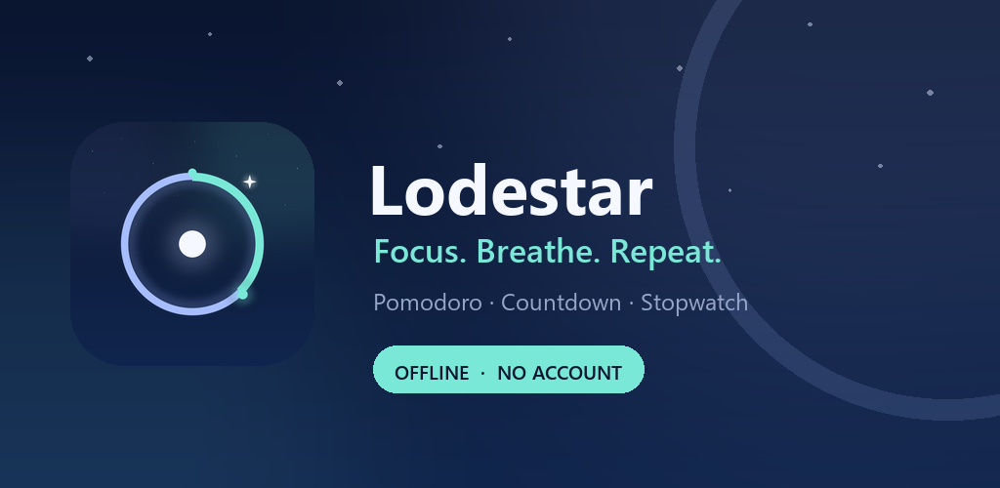

# Lodestar - Pomodoro & Everyday Timer

A native Android focus timer built from the supplied product package in `docs/reference/`.
Kotlin + Jetpack Compose + Material 3 + Room + DataStore, offline-first, no account required.

**Status:** signed 1.0.2 release candidate built. 15 timer-engine unit tests pass; lint passes with no errors;
the release APK was installed and exercised on an Android 16 / API 36 emulator. The AAB and APK are in
`dist/` and on the GitHub release.

<p align="center">
  
  
  
  
</p>
<p align="center">
  
  
  
  
</p>

## What is implemented

### Timing

- **Focus / Pomodoro:** configurable focus, short break and long break durations; long break after N work stages; optional auto-start for breaks and next focus; “Break ready” hand-off instead of silently starting a break.
- **Quick Timer:** arbitrary countdown with HH:MM:SS editing, 5/10/15/30/45/60 minute presets, a saved 8-minute stretching preset, and +5 minutes while running.
- **Stopwatch:** counts up, pauses, resumes and resets; elapsed time is derived from monotonic anchors, not a decrementing counter.
- **One active session at a time**, enforced through a serialized repository and a single-room-row design.
- **Restart safe:** deadlines persist in Room. Same-boot timing uses `SystemClock.elapsedRealtime()`; after reboot it reconstructs conservatively from the persisted wall deadline. Boot identity comes from `/proc/sys/kernel/random/boot_id` (with `BOOT_COUNT` and an offset fallback), so a manual clock change is not mistaken for a reboot.
- **Idempotent completion:** the completion event ID is `${sessionId}:${stageIndex}:COMPLETED`, so a replayed alarm or rapid callback cannot create a second history row or reward.
- **Foreground watchdog:** if an inexact OS alarm is late while the app is visible, a once-per-second check dispatches the same idempotent completion command instead of leaving the UI at `00:00`.
- **Background notification:** ongoing notification with a native countdown chronometer and Pause/Resume, Skip and Stop actions that dispatch through the same command processor as the UI.
- **Completion alert:** high-priority notification, a sound chosen by the user, and a short vibration; all work even if notification permission is denied because sound/haptics are played directly by the receiver.
- **Exact/inexact alarms:** exact alarms are used when Android grants access; otherwise `setAndAllowWhileIdle` is used and the UI honestly reports that alerts may be delayed. No foreground service is used.
- **Boot & package-replace recovery:** `BootReceiver` reconciles and reschedules the upcoming stage.

### Product surfaces

- Home with Focus / Timer / Stopwatch modes and last-used-mode memory.
- Active session, paused state, countdown completion, “Break ready” and “Focus ready” states.
- Tasks with tag, estimate, completion toggle and optional task linkage to a focus session.
- Insights: week/month/year ranges, focus minutes, previous-period comparison, daily bars, 28-day heatmap, streak, completed sessions and most-focused window.
- Constellations: original, non-punitive milestone visual driven by completed sessions.
- Routine editor: durations, long-break cadence, auto-start options and haptics.
- Preferences: three themes (Midnight Orbit, Warm Paper, Quiet Aurora), reduced motion, high contrast, notification/sound/chime/haptic settings, exact-alarm status, CSV export through Android SAF, and history deletion with confirmation.
- Optional Plus screen. The price is explicitly labelled **Illustrative**; no fake checkout exists.

## Screens

| Screen | File |
| --- | --- |
| Home / Focus | `docs/screenshots/01-home.png` |
| Active focus | `docs/screenshots/02-active-focus.png` |
| Paused | `docs/screenshots/02d-paused.png` |
| Background resume | `docs/screenshots/02c-background-resume.png` |
| Process-death restore | `docs/screenshots/02e-process-death-restore.png` |
| Break ready | `docs/screenshots/02b-break-ready.png` |
| Quick Timer | `docs/screenshots/03-quick-timer.png` |
| Countdown running | `docs/screenshots/04-active-countdown.png` |
| Countdown complete | `docs/screenshots/04-active-countdown-complete.png` |
| Foreground watchdog | `docs/screenshots/04b-watchdog-complete.png` |
| Tasks | `docs/screenshots/05-tasks.png` |
| Insights | `docs/screenshots/06-insights.png` |
| Preferences | `docs/screenshots/07-settings.png` |
| Constellations | `docs/screenshots/08-constellations.png` |
| Routine | `docs/screenshots/09-routine.png` |
| Lodestar Plus | `docs/screenshots/10-plus.png` |

All screenshots were captured from the running debug APK, not from the HTML reference package.

## Play Store assets

<p align="center">
  
  
</p>

The release asset pack lives in `docs/play/`:

- `icon-512.png` — Play Store icon
- `icon-1024.png` — source icon
- `feature-graphic-1024x500.png` — Play feature graphic
- `screenshots/01-home.png` … `08-themes.png` — eight 1080×1920 framed store screenshots

See `docs/play/README.md` for the caption order and requirements. Regenerate with
`python tools/generate_assets.py`.

## Release artifacts

The signed release build is produced locally (the keystore is never committed):

- `app/build/outputs/bundle/release/app-release.aab`
- `app/build/outputs/apk/release/app-release.apk`
- copies are placed in `dist/` as `lodestar-1.0.2.aab` and `lodestar-1.0.2.apk`

The `keystore.properties` file is git-ignored. The signed `dist/` artifacts are committed so they can be
downloaded directly from the repository. A local backup of the keystore and password file was created at
`C:\Users\mmkha\Lodestar-signing-backup.zip`; move it to a secure vault or password manager. Back up
the original key at `C:\Users\mmkha\.android\keystores\orbit-release.jks` before publishing or handing
the project to anyone else.

## Architecture

```
app/src/main/java/com/covenants/pomodorotimer/
  core/model/        Domain enums and immutable models
  core/time/         TimeSource (monotonic, wall, zone, boot identity) + fake clock
  core/domain/       Pure TimerEngine transitions and TimeFormat helpers
  data/db/           Room entities, DAOs, versioned database
  data/              DataStore settings, TimerRepository command processor
  platform/          AlarmScheduler, receivers, notification, sound/haptics
  ui/                ViewModel, Compose navigation, theme, components, screens
```

- **Single activity, unidirectional flow.** `MainViewModel` combines Room, DataStore and a display tick into `StateFlow<AppUiState>`.
- **The reducer is pure.** `TimerEngine` has no Android dependency and is covered by JVM tests with `FakeTimeSource`.
- **All commands are serialized** through `TimerRepository` with a `Mutex`; state is committed to Room before alarms or notifications are touched.
- **Room is authoritative.** Settings/routine live in DataStore. History is immutable and local.
- **Manual constructor injection** through `AppContainer`. See `docs/adr/ADR-003-dependency-injection.md` for why Hilt was not introduced in this build.
- **No backend, no Firebase, no network permission.** Core behavior is fully offline.

## Build & install

Prerequisites: JDK 17+ (the Android Studio JBR works), Android SDK with platform 36 and build-tools 36.

```bash
# Windows (PowerShell)
$env:JAVA_HOME="C:\Program Files\Android\Android Studio\jbr"
$env:ANDROID_HOME="$env:LOCALAPPDATA\Android\Sdk"
.\gradlew.bat --no-daemon assembleDebug

# macOS / Linux
export JAVA_HOME=/path/to/jdk17
export ANDROID_HOME=$HOME/Android/Sdk
./gradlew --no-daemon assembleDebug
```

`local.properties` is intentionally git-ignored. Create it with your own SDK path:

```properties
sdk.dir=/path/to/Android/Sdk
```

Install and launch:

```bash
adb install -r app/build/outputs/apk/debug/app-debug.apk
adb shell am start -n com.covenants.pomodorotimer/.MainActivity
```

Run tests and lint:

```bash
./gradlew --no-daemon testDebugUnitTest
./gradlew --no-daemon lintDebug
```

Release signing is not configured. See `docs/release-checklist.md` before producing a Play bundle.

## Permissions

| Permission | Why | If denied |
| --- | --- | --- |
| `POST_NOTIFICATIONS` | Active timer status and completion alerts | Timer still runs; UI explains alerts are off; fallback sound/haptics still attempt to play |
| `SCHEDULE_EXACT_ALARM` | User-granted precise alert on Android 12–12L (`maxSdkVersion=32`) | Falls back to inexact allow-while-idle alarm; UI warns that alerts may be delayed |
| `USE_EXACT_ALARM` | Auto-granted precise alerts on Android 13+ for a core timer app | Android still enforces its policy; the app checks `canScheduleExactAlarms()` and degrades honestly |
| `USE_FULL_SCREEN_INTENT` | Optional full-screen completion alert over the lock screen | Notification stays high-priority but does not take over the screen; setting is opt-in |
| `RECEIVE_BOOT_COMPLETED` | Reconcile and reschedule after reboot | Timer still restores from persisted state when the app is opened |
| `VIBRATE` | Optional completion haptic | No vibration; all other behavior unchanged |

The completion alert uses a high-importance channel with the alarm audio stream. The app only plays a
direct fallback sound when notifications are denied, so the same alert is not played twice. Full-screen
alerts are off by default and require the Android 14+ user grant; the Settings screen links to it.

No `AccessibilityService`, `QUERY_ALL_PACKAGES`, `UsageStats`, location, contacts, broad storage or foreground-service permissions are used. CSV export uses the Android Storage Access Framework.

## Verified evidence

| Check | Result |
| --- | --- |
| `testDebugUnitTest` | **PASS**, 15 tests |
| `lintDebug` | **PASS**, 0 errors |
| `assembleDebug` | **PASS** |
| `bundleRelease` / `assembleRelease` | **PASS**, R8 minified + resource shrinking |
| Signed AAB / APK | **PASS** — `jarsigner` verified the AAB; `apksigner` verified the APK (v2 scheme) |
| Room migration 1 → 2 | **PASS** — upgrading the installed debug build preserved sessions and added `activeStartedWallMs` |
| Install release APK on API 36 emulator | **PASS** — no R8-related crash |
| 5-second countdown completion | **PASS** — one history row, one completion notification on the alarm-stream channel |
| 1-minute focus completion | **PASS** — “Break ready”, one completed work stage |
| Background screen-off timing | **PASS** — accurate remaining after 12 seconds off-screen; native chronometer notification |
| Pause while backgrounded | **PASS** — notification shows “Paused · 00:29 remaining” |
| Process death + relaunch | **PASS** — force-stopped mid-countdown; relaunch restored and auto-opened the live screen with the correct remaining time |
| Foreground watchdog completion | **PASS** — 30-second countdown reached 00:00 and completed while visible, without waiting for an alarm |
| Exact-alarm access | **PASS** — `USE_EXACT_ALARM` grants precise alarms on the test device; Settings shows “Allowed” |
| Notification channel sound | **PASS** — channels report `USAGE_ALARM`; bell uses `alarm_alert` |
| Populated insights | **PASS** — 1m, 1 session, 1-day streak, singular copy |
| Play assets | **PASS** — icon 512/1024, feature graphic, 8 × 1080×1920 screenshots |
| Physical-device OEM matrix | **NOT RUN** — needs Pixel/Samsung/Xiaomi-class hardware |
| Notification-denied path | **NOT RUN** as a device test |
| TalkBack / 200% font | **NOT RUN** as a device test |

See `docs/test-matrix.md` for the full T-001–T-016 matrix and honest status.

## Known limitations

- Exact completion alerts are ultimately controlled by Android/OEM battery policy. `USE_EXACT_ALARM` plus `SCHEDULE_EXACT_ALARM` improve this for a core timer app, but the app never claims a notification is guaranteed.
- Full-screen alerts are opt-in and require the Android 14+ full-screen-intent grant; without it the high-priority notification is still delivered.
- Force-stopping the app from Android settings blocks alarms until the app is opened again; the session is reconstructed on next launch.
- Stopwatch recovery after a reboot uses the persisted wall-clock anchor and is therefore approximate; the countdown path uses the same conservative fallback.
- No Google Play Billing implementation. The Plus screen is a truthful placeholder.
- No ambient audio packs, home-screen widget, cloud sync, app blocking, lap list, or onboarding flow yet.
- Single-module build for clarity; package boundaries are prepared for later feature modules.
- Only the default `en` strings are present; UI copy is ready for localization but not translated.
- The release keystore is local and not in git. Back up `C:\Users\mmkha\.android\keystores\orbit-release.jks`, `keystore.properties`, and `C:\Users\mmkha\Lodestar-signing-backup.zip` before publishing.
- Play Console requires declarations for both `USE_EXACT_ALARM` and `USE_FULL_SCREEN_INTENT`, even though the full-screen alert is optional and off by default.
- **Lodestar** was selected after an informal search. Check USPTO serial #90477866 and get a short attorney review before investing in the brand.
- Physical-device tests on Pixel, Samsung and Xiaomi-class hardware are still required before a public release.

## Documentation

- `docs/adr/ADR-001-timer-timebase.md`
- `docs/adr/ADR-002-alarm-policy.md`
- `docs/adr/ADR-003-dependency-injection.md`
- `docs/test-matrix.md`
- `docs/privacy-policy.md`
- `docs/store-listing.md`
- `docs/release-checklist.md`
- `docs/reference/` — the supplied research, PRD, UI gallery, engineering spec, agent brief and contact sheet

## Attribution

The implementation is original. The supplied HTML package is an internal planning artifact dated 9 November 2026. Competitor names and any third-party marks belong to their respective owners. **Lodestar** was selected after an informal App Store/Play/USPTO search; this is not formal legal clearance. Check USPTO serial #90477866 and get a short attorney review before investing in the brand.
